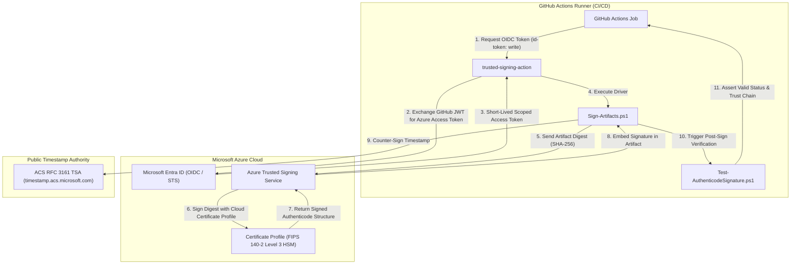
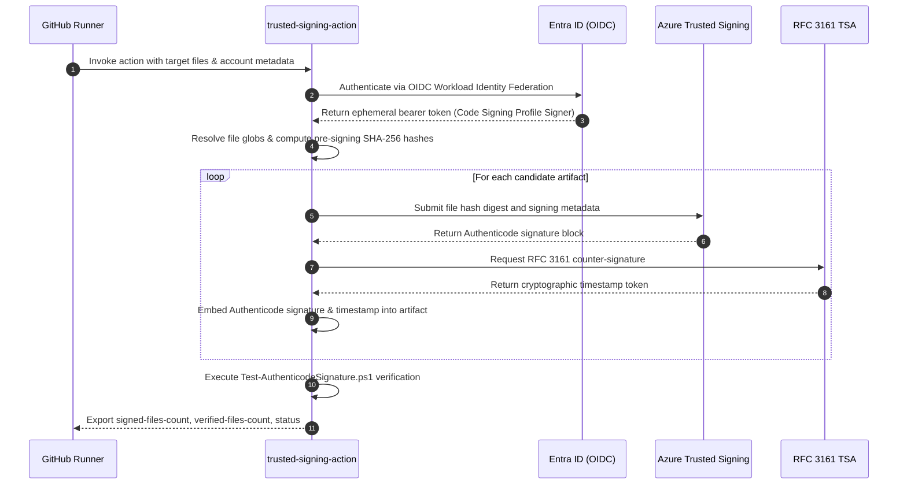

# Azure Trusted Signing Action

[](LICENSE)
[](.github/workflows/ci.yml)
[](SECURITY.md)
[](#azure-setup-guide-oidc--rbac)
[](#supported-file-types)

Enterprise-grade, zero-credential GitHub Composite Action for **Microsoft Azure Trusted Signing** (formerly Azure Code Signing / ACS). Enables automated, tamper-proof Authenticode signing and cryptographic verification across PowerShell scripts, compiled binaries, installers, and packages without storing long-lived credentials, PFX certificates, or private keys in CI/CD secrets.

---

## Architecture & Security Model

Azure Trusted Signing replaces legacy hardware HSMs and static PFX files with Microsoft-managed cloud PKI integrated with Microsoft Entra ID. Authentication is performed via passwordless **OpenID Connect (OIDC)** federated credentials.



### Execution Sequence



---

## Action Inputs & Outputs

### Inputs

| Parameter | Type | Required | Default | Description |
| :--- | :---: | :---: | :--- | :--- |
| `azure-tenant-id` | String | No | `""` | Azure Tenant ID for passwordless Azure OIDC federated authentication. |
| `azure-client-id` | String | No | `""` | Azure Client ID (Application ID) for passwordless Azure OIDC authentication. |
| `endpoint` | String | No | `https://eus.codesigning.azure.net/` | Azure Trusted Signing regional endpoint URL. |
| `trusted-signing-account-name` | String | **Yes** | — | Azure Trusted Signing account resource name. |
| `certificate-profile-name` | String | **Yes** | — | Certificate profile name within the Trusted Signing account. |
| `files` | String | **Yes** | — | Glob pattern, single path, or multiline list of files to sign. |
| `timestamp-rfc3161` | String | No | `http://timestamp.acs.microsoft.com` | RFC 3161 compliant timestamp server URL. |
| `timestamp-digest` | String | No | `SHA256` | Hash algorithm for timestamp counter-signature (`SHA256`, `SHA384`, `SHA512`). |
| `file-digest` | String | No | `SHA256` | File digest algorithm (`SHA256`, `SHA384`, `SHA512`). |
| `verify` | Boolean | No | `true` | Automatically verify Authenticode signatures post-signing. |
| `fail-on-warning` | Boolean | No | `false` | Strictly fail the CI workflow step if warnings occur. |
| `dry-run` | Boolean | No | `false` | Simulate signing without invoking remote Azure endpoints. |

### Outputs

| Parameter | Type | Description |
| :--- | :---: | :--- |
| `signed-files-count` | Number | Total number of artifacts successfully signed. |
| `verified-files-count` | Number | Total number of artifacts successfully verified post-signing. |
| `signing-status` | String | Outcome status: `success`, `warning`, or `error`. |

---

## Supported File Types

The action natively processes and signs all Windows Authenticode file formats:

| Format Category | Supported Extensions |
| :--- | :--- |
| **PowerShell Scripts** | `.ps1`, `.psm1`, `.psd1` |
| **PE Binaries** | `.exe`, `.dll`, `.sys`, `.ocx` |
| **Windows Installers** | `.msi`, `.msp`, `.msm` |
| **Package / Catalogs** | `.cat`, `.cab` |
| **AppX / MSIX Packages** | `.appx`, `.appxbundle`, `.msix`, `.msixbundle` |

---

## Quickstart & Usage Examples

### 1. PowerShell Script Signing Workflow

```yaml
name: Sign PowerShell Scripts

on:
  push:
    branches: [main]

permissions:
  id-token: write  # Critical for Azure OIDC federation
  contents: read

jobs:
  sign:
    runs-on: windows-latest
    steps:
      - name: Checkout Code
        uses: actions/checkout@v4

      - name: Sign & Verify PowerShell Scripts
        id: sign-scripts
        uses: koality-assured/trusted-signing-action@v1
        with:
          azure-tenant-id: ${{ secrets.AZURE_TENANT_ID }}
          azure-client-id: ${{ secrets.AZURE_CLIENT_ID }}
          endpoint: https://eus.codesigning.azure.net/
          trusted-signing-account-name: ${{ secrets.AZURE_TRUSTED_SIGNING_ACCOUNT }}
          certificate-profile-name: ${{ secrets.AZURE_CERTIFICATE_PROFILE }}
          files: |
            scripts/**/*.ps1
            modules/**/*.psm1
            modules/**/*.psd1
          verify: true
          fail-on-warning: true
```

### 2. Compiled Binary Signing (.exe, .dll, .msi)

```yaml
name: Release Binary Signing

on:
  release:
    types: [published]

permissions:
  id-token: write
  contents: write

jobs:
  release-signing:
    runs-on: windows-latest
    steps:
      - name: Checkout Repository
        uses: actions/checkout@v4

      - name: Build Application
        run: dotnet publish -c Release -o dist/bin

      - name: Sign Binaries with Azure Trusted Signing
        id: sign-binaries
        uses: koality-assured/trusted-signing-action@v1
        with:
          azure-tenant-id: ${{ secrets.AZURE_TENANT_ID }}
          azure-client-id: ${{ secrets.AZURE_CLIENT_ID }}
          endpoint: https://eus.codesigning.azure.net/
          trusted-signing-account-name: ${{ secrets.AZURE_TRUSTED_SIGNING_ACCOUNT }}
          certificate-profile-name: ${{ secrets.AZURE_CERTIFICATE_PROFILE }}
          files: |
            dist/bin/**/*.exe
            dist/bin/**/*.dll
            dist/bin/**/*.msi
          verify: true
          fail-on-warning: true
```

---

## Azure Setup Guide (OIDC & RBAC)

To achieve zero-credential code signing, configure passwordless Azure Workload Identity Federation:

### Step 1: Create Trusted Signing Account & Certificate Profile

1. In the Azure Portal or Azure CLI, create a **Trusted Signing Account** (e.g. `ka-trusted-signing-eus`).
2. Complete identity validation (Public Trust or Private Trust).
3. Create a **Certificate Profile** (e.g. `ka-production-profile`).

### Step 2: Register Microsoft Entra ID App with OIDC Federated Credential

1. In Microsoft Entra ID, register an Application (e.g. `gh-trusted-signing-runner`).
2. Under **Certificates & secrets** > **Federated credentials**, click **Add credential**.
3. Select **GitHub Actions deploying Azure resources**.
4. Configure organization and repository mapping:
   - **Organization:** `koality-assured`
   - **Repository:** `your-target-repo`
   - **Entity Type:** `Branch` (e.g. `main`) or `Environment`.

### Step 3: Grant Least-Privilege Role Assignment

Grant the App Registration access **only** to sign with the specific Certificate Profile:

```bash
# Assign 'Code Signing Certificate Profile Signer' role
az role assignment create \
  --assignee "<AZURE_CLIENT_ID>" \
  --role "Code Signing Certificate Profile Signer" \
  --scope "/subscriptions/<SUB_ID>/resourceGroups/<RG>/providers/Microsoft.CodeSigning/codeSigningAccounts/<ACCOUNT>/certificateProfiles/<PROFILE>"
```

### Step 4: Configure GitHub Secrets

Store the non-secret configuration variables in your GitHub repository:
- `AZURE_CLIENT_ID`: Application (client) ID of your registered app.
- `AZURE_TENANT_ID`: Microsoft Entra tenant ID.
- `AZURE_TRUSTED_SIGNING_ACCOUNT`: Name of the Trusted Signing account.
- `AZURE_CERTIFICATE_PROFILE`: Name of the certificate profile.

---

## Exit Codes & CI Gating

The action and underlying PowerShell drivers adhere to standardized exit codes:

| Exit Code | Classification | Meaning |
| :---: | :---: | :--- |
| `0` | **Success** | All matched artifacts were signed and verified without errors. |
| `1` | **Warning** | Non-fatal warnings encountered (e.g. no files matched pattern with `fail-on-warning: true`). |
| `2` | **Error** | Fatal failure: file unreadable, Azure signing rejected, hash mismatch, or signature verification failed. |

---

## Testing & Antagonistic Security Review

The repository includes a comprehensive Python test suite and the Koality Assured Antagonistic Security & Sanitization Review Engine:

```bash
# 1. Run unit and integration tests
python -m pytest -v

# 2. Run adversarial review (Zero leaks, cryptographic SHA-256 integrity, syntax check)
python adversarial_review.py
```

---

## License

This project is licensed under the [Apache License 2.0](LICENSE). Copyright 2026 Koality Assured.
